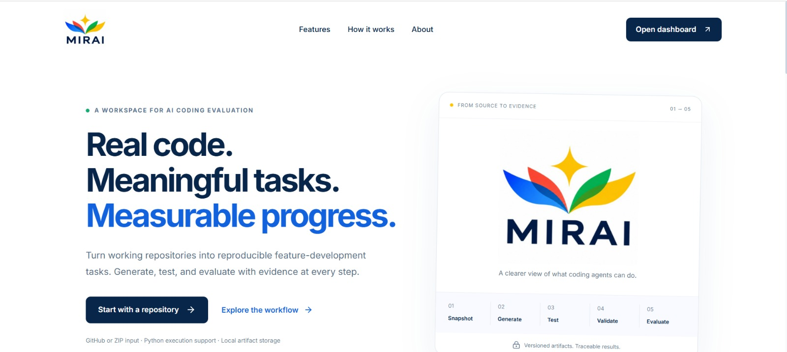
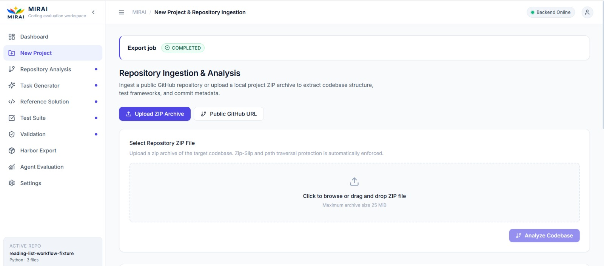
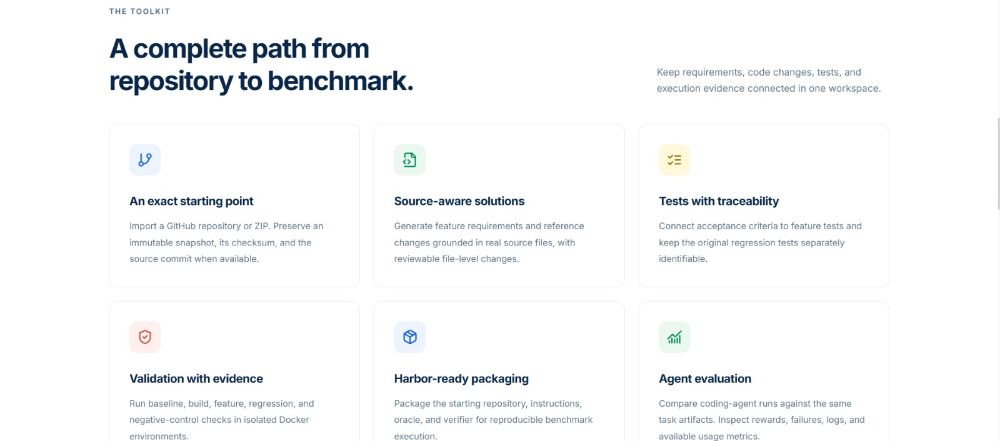
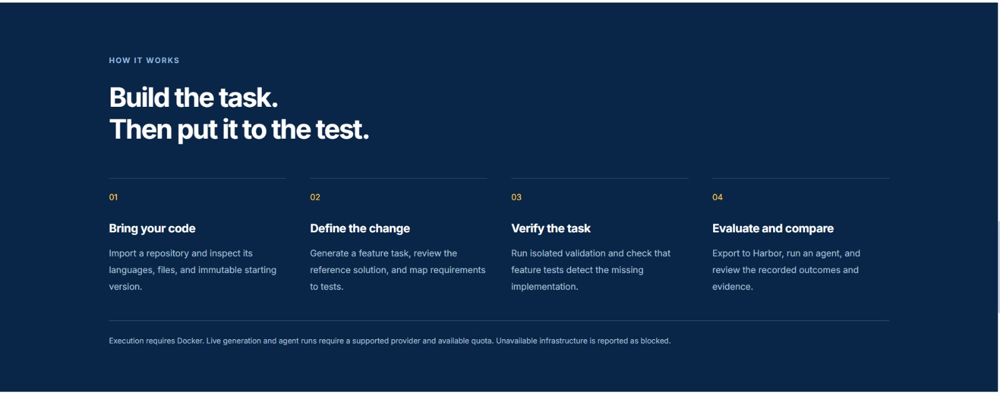
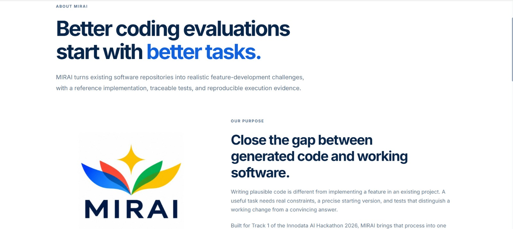
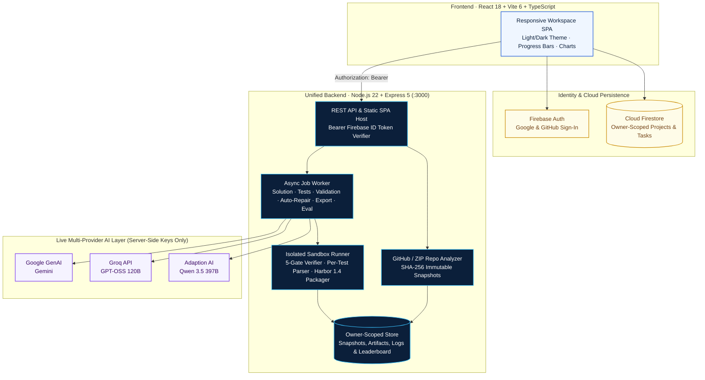

<style>
  @keyframes miraiFadeSlideUp {
    0% {
      opacity: 0;
      transform: translateY(16px);
    }
    100% {
      opacity: 1;
      transform: translateY(0);
    }
  }

  @keyframes miraiSoftGlow {
    0%, 100% {
      box-shadow: 0 4px 18px rgba(26, 86, 219, 0.08);
    }
    50% {
      box-shadow: 0 8px 28px rgba(14, 165, 233, 0.18);
    }
  }

  .mirai-logo {
    border-radius: 16px;
    transition: transform 0.32s cubic-bezier(0.22, 1, 0.36, 1), box-shadow 0.32s ease;
  }

  .mirai-logo:hover {
    transform: translateY(-4px) scale(1.03);
    box-shadow: 0 12px 28px rgba(11, 31, 58, 0.16);
  }

  .mirai-showcase-img {
    border-radius: 10px;
    border: 1px solid rgba(148, 163, 184, 0.25);
    transition: transform 0.3s cubic-bezier(0.22, 1, 0.36, 1), box-shadow 0.3s ease, border-color 0.3s ease;
  }

  .mirai-showcase-img:hover {
    transform: translateY(-4px) scale(1.018);
    border-color: rgba(26, 86, 219, 0.55);
    box-shadow: 0 14px 30px rgba(11, 31, 58, 0.18);
  }

  .mirai-workflow-section {
    animation: miraiFadeSlideUp 0.7s cubic-bezier(0.22, 1, 0.36, 1) both;
  }

  .mirai-workflow-diagram {
    border-radius: 16px;
    animation: miraiFadeSlideUp 0.75s cubic-bezier(0.22, 1, 0.36, 1) 0.1s both, miraiSoftGlow 4.5s ease-in-out infinite;
    transition: transform 0.3s cubic-bezier(0.22, 1, 0.36, 1), box-shadow 0.3s ease;
  }

  .mirai-workflow-diagram:hover {
    transform: translateY(-3px) scale(1.008);
    box-shadow: 0 16px 34px rgba(11, 31, 58, 0.18);
  }

  @media (prefers-reduced-motion: reduce) {
    .mirai-workflow-section,
    .mirai-workflow-diagram {
      animation: none;
    }
    .mirai-logo,
    .mirai-showcase-img,
    .mirai-workflow-diagram {
      transition: none;
    }
  }
</style>

<div align="center">

<!-- Animated Header Wave -->


<br />

<!-- Official MIRAI Logo -->


<br />
<br />

<!-- Animated Typing Tagline -->
<a href="#mirai-workflow">
  
</a>

<br />

<!-- Tech & Hackathon Badges -->
<p>
  
  
  
</p>

<p>
  
  
  
  
  
  
  
  
  
</p>

<!-- Quick Section Navigation -->
<p>
  <a href="#why-mirai">Overview</a> •
  <a href="#standout-capabilities">Capabilities</a> •
  <a href="#product-showcase">Showcase</a> •
  <a href="#mirai-workflow">MIRAI Workflow</a> •
  <a href="#system-architecture">Architecture</a> •
  <a href="#quick-start">Quick Start</a> •
  <a href="#hackathon-requirement-mapping">Track 1 Rubric</a>
</p>

</div>

---

## Why MIRAI?

**MIRAI** is a full-stack **Coding Task Factory** built for **Track 1 of the Innodata AI Hackathon 2026**. It transforms real software repositories into reproducible, evidence-backed coding benchmarks — bridging the gap between plausible generated snippets and verified working software.

From a single workspace, MIRAI captures an immutable repository snapshot, authors a source-grounded feature specification and reviewable reference patch, builds requirement-traceable feature and regression tests, executes five isolated validation gates (with **1-click AI Auto-Repair**), exports a **Harbor 1.4** benchmark package, and benchmarks frontier coding agents side by side with **granular per-test scoring** and **multi-task visual leaderboards**.

> [!IMPORTANT]
> **Built for Reproducible Evidence — Zero Mock Verification**
> Every validation gate and every Stage 5 agent submission is compiled and executed inside a fresh, secret-stripped isolated workspace. Feature tests must fail on the untouched baseline (negative control) and pass only when a real working implementation is applied without breaking existing regression suites or modifying protected test files.

---

## Standout Capabilities

<table>
  <tr>
    <td width="50%" valign="top">
      <h3>1. Immutable Repository Intake</h3>
      <p>Ingest public <b>GitHub repositories</b> (with optional commit SHA pinning) or local <b><code>.zip</code> archives</b> with Zip-Slip path-traversal protection, SHA-256 content addressing, language detection, and framework discovery.</p>
    </td>
    <td width="50%" valign="top">
      <h3>2. Source-Aware Task, Patch & Test Synthesis</h3>
      <p>Uses the official <code>@google/genai</code> SDK to generate grounded feature specifications, reviewable file-level reference patches, and requirement-mapped feature tests while keeping original repository regression tests intact.</p>
    </td>
  </tr>
  <tr>
    <td width="50%" valign="top">
      <h3>3. 5-Gate Validation + 1-Click AI Auto-Repair</h3>
      <p>Runs baseline checks, reference patch apply + syntax verification (<code>py_compile</code> / <code>node --check</code>), real feature tests, regression tests, and negative-control checks. If any gate fails, <b>Auto-Fix with AI</b> reads real <code>stderr</code> logs and repairs the patch or test suite automatically.</p>
    </td>
    <td width="50%" valign="top">
      <h3>4. Complete Harbor 1.4 Benchmark Packaging</h3>
      <p>Generates downloadable Harbor 1.4 ZIP packages separating public <code>instruction.md</code>, <code>task.toml</code>, <code>environment/Dockerfile</code> + <code>repo/</code>, oracle <code>solution/solve.sh</code>, and verifier <code>tests/test.sh</code> writing deterministic <code>1.0</code> / <code>0.0</code> rewards to <code>/logs/verifier/reward.txt</code>.</p>
    </td>
  </tr>
  <tr>
    <td width="50%" valign="top">
      <h3>5. Granular Test-Case Scoring & Protected-Test Guard</h3>
      <p>Evaluates <b>Gemini</b>, <b>GPT-OSS 120B (Groq)</b>, and <b>Qwen 3.5 397B (Adaption AI)</b> alongside Oracle and Baseline No-Op controls. Surfaces individual test-case statuses (<code>PASSED</code> / <code>FAILED</code> / <code>ERROR</code> / <code>SKIPPED</code>), partial scores (%), and explicitly guards read-only original test files across all agents.</p>
    </td>
    <td width="50%" valign="top">
      <h3>6. Multi-Task Model Leaderboard & Cloud Sync</h3>
      <p>Aggregates all evaluated tasks into an interactive <b>Model Leaderboard</b> (<code>/leaderboard</code>) with visual bar charts for Pass Rate, Partial Score, Latency, Token Usage, and Failure Categories — plus Firebase Auth (Google/GitHub), owner-scoped Firestore persistence, and 1-click Cloud Restore.</p>
    </td>
  </tr>
</table>

---

## Product Showcase

<div align="center">

<table>
  <tr>
    <td align="center" width="50%">
      <a href="./screenshot/1.jpeg">
        
      </a>
      <br />
      <sub><b>Landing Experience</b> — Source-to-evidence coding evaluation overview</sub>
    </td>
    <td align="center" width="50%">
      <a href="./screenshot/5.jpeg">
        
      </a>
      <br />
      <sub><b>Authenticated Workspace</b> — ZIP & GitHub ingestion with live job status</sub>
    </td>
  </tr>
  <tr>
    <td align="center" width="50%">
      <a href="./screenshot/2.jpeg">
        
      </a>
      <br />
      <sub><b>Benchmark Toolkit</b> — Immutable snapshots, traceable tests, Harbor export & agent eval</sub>
    </td>
    <td align="center" width="50%">
      <a href="./screenshot/4.jpeg">
        
      </a>
      <br />
      <sub><b>4-Phase Factory Flow</b> — Bring your code, define, verify, and evaluate</sub>
    </td>
  </tr>
</table>

<details>
  <summary><b>View More — About & Design Philosophy Screenshot</b></summary>
  <br />
  <a href="./screenshot/3.jpeg">
    
  </a>
  <br />
  <sub><b>About MIRAI</b> — Closing the gap between generated code and verified working software</sub>
</details>

</div>

---

## MIRAI Workflow

<div class="mirai-workflow-section" align="center">

<!-- Animated CSS Keyframe Workflow Diagram (runs natively on GitHub & Markdown viewers) -->
<a href="./docs/mirai-workflow-animated.svg">
  
</a>

</div>

<br />

| Stage | Workspace Route | What Happens | Verified Artifact |
| :---: | :--- | :--- | :--- |
| **01** | `/new-project` | Analyze a GitHub URL (with optional commit SHA) or `.zip` archive | Immutable `snapshot_id` + SHA-256 manifest |
| **02** | `/task-generator` | Generate a contextual feature specification with live stage progress bar | Structured task spec + acceptance criteria |
| **03** | `/solution` & `/test-suite` | Synthesize file-level reference patch and requirement-mapped tests | Reviewable patch + feature/regression suites |
| **04** | `/validation` | Run 5 isolated gates (Baseline, Build, Feature, Regression, Negative Control) + optional **Auto-Fix with AI** | Per-gate pass/fail verdict + full stdout/stderr logs |
| **05** | `/export` | Assemble a Harbor 1.4-compatible benchmark archive | Downloadable `.zip` (`task.toml`, `solve.sh`, `test.sh`) |
| **06** | `/evaluation` & `/leaderboard` | Benchmark Oracle, Baseline No-Op, Gemini, GPT-OSS 120B, and Qwen 3.5 397B with Protected-Test Guard | Per-test breakdown, Partial Score %, Charts & CSVs |

```mermaid
flowchart LR
    classDef navy fill:#0B1F3A,stroke:#1A56DB,color:#FFFFFF,stroke-width:2px
    classDef blue fill:#1A56DB,stroke:#0EA5E9,color:#FFFFFF,stroke-width:2px
    classDef teal fill:#0F766E,stroke:#14B8A6,color:#FFFFFF,stroke-width:2px
    classDef amber fill:#B45309,stroke:#F59E0B,color:#FFFFFF,stroke-width:2px

    S0["01 · Repo Intake<br/>GitHub SHA / ZIP<br/>SHA-256 Snapshot"]:::navy
    S1["02 · Task Synthesis<br/>Grounded Spec &<br/>Acceptance Criteria"]:::blue
    S2["03 · Solution & Tests<br/>Reference Patch +<br/>Traceable Suites"]:::blue
    S3["04 · 5-Gate Validation<br/>Isolated Sandbox +<br/>1-Click AI Auto-Repair"]:::amber
    S4["05 · Harbor 1.4 Export<br/>Dockerfile, Oracle &<br/>Verifier Archive"]:::teal
    S5["06 · Agent Evaluation<br/>Gemini · GPT-OSS · Qwen<br/>Granular Score & Leaderboard"]:::navy

    S0 --> S1 --> S2 --> S3
    S3 -. "Auto-Repair on Failure" .-> S2
    S3 --> S4 --> S5
```

<details>
  <summary><b>View Interactive Mermaid Workflow Graph</b></summary>



</details>

> [!TIP]
> **Workspace Navigation**
> - **Public routes**: Landing (`/`), About (`/about`)
> - **Authenticated workspace**: Dashboard (`/dashboard`), New Project (`/new-project`), Task Generator (`/task-generator`), Reference Solution (`/solution`), Test Suite (`/test-suite`), Validation (`/validation`), Harbor Export (`/export`), Agent Evaluation (`/evaluation`), Model Leaderboard (`/leaderboard`), Settings (`/settings`)

---

## Multi-Model Agent Evaluation & Leaderboard

Stage 5 runs deterministic control baselines alongside three live frontier coding agents against the exact same immutable repository snapshot and hidden verifier:

| Agent / Control | Provider & Model Identifier | Role in Benchmark | Safeguards & Scoring |
| :--- | :--- | :--- | :--- |
| **Oracle Control** | Reference Solution Patch | Upper-bound verification (`reward = 1.0`) | Confirms benchmark is solvable |
| **Baseline Control** | Untreated Repository (No-Op) | Lower-bound verification (`reward = 0.0`) | Confirms feature tests reject missing code |
| **Gemini Agent** | `gemini/gemini-4-hydrogen` (`@google/genai`) | Live frontier coding agent | Protected-Test Guard + Per-test breakdown |
| **GPT-OSS 120B** | `groq/openai/gpt-oss-120b` (Groq API) | Live open-weight coding agent | Protected-Test Guard + Per-test breakdown |
| **Qwen 3.5 397B** | `adaption/qwen3.5-397b` (131K) / `SEA-LION-v5` (262K) | Live large-context coding agent | Protected-Test Guard + Per-test breakdown |

### Why Granular Scoring + Protected-Test Guard Matter
- **Beyond Binary 0/1**: Alongside strict Harbor trial pass rates (`reward = 1.0`), every trial reports exact **Feature Cases (`passed/total`)**, **Regression Cases (`passed/total`)**, individual test-case badges (`PASSED`, `FAILED`, `ERROR`, `SKIPPED`), and a weighted **Partial Score (%)** so judges can clearly observe partial progress between models.
- **Fair Integrity Checks**: The exact deduplicated list of original regression test files is passed as a read-only guard to all three live agents and excluded from editable priority paths — preventing accidental `modified_protected_tests` penalties while keeping the verifier's tampering detector strictly enforced.
- **Cross-Task Analytics (`/leaderboard`)**: Combines all evaluated tasks into interactive visual bar charts comparing **Pass Rate / Partial Score**, **Average Latency**, **Token Usage**, and **Failure Categories**, complete with one-click `leaderboard.csv`, `summary.csv`, and `trials.csv` exports.

---

## System Architecture



<details>
  <summary><b>Explore Repository Structure</b></summary>

```text
.
├── server.ts                       # Unified Express 5 API + SPA server (port 3000)
├── server/
│   ├── repoAnalyzer.ts             # GitHub & ZIP intake, SHA-256 snapshots & metadata extraction
│   ├── sandboxRunner.ts            # Isolated workspace runner, syntax checks & per-test case parser
│   ├── gemini.ts                   # @google/genai task, solution, test, auto-repair & Gemini agent
│   ├── groq.ts                     # Groq OpenAI-compatible client (GPT-OSS 120B + Protected-Test Guard)
│   ├── adaption.ts                 # Adaption AI client (Qwen 3.5 397B + Protected-Test Guard)
│   ├── harborBuilder.ts            # 5-gate validator, Harbor 1.4 ZIP builder & granular agent verifier
│   ├── firebaseAuth.ts             # Server-side Firebase ID token verification
│   ├── store.ts                    # Owner-scoped snapshots, tasks, jobs, leaderboard & CSV exports
│   └── types.ts                    # Shared backend TypeScript contracts
├── frontend/
│   ├── src/
│   │   ├── pages/                  # Landing, About, Dashboard, NewProject, TaskGenerator,
│   │   │                           # ReferenceSolution, TestSuite, Validation, HarborExport,
│   │   │                           # Evaluation, Leaderboard, Settings
│   │   ├── components/             # AppSidebar (responsive drawer), TopNavbar, AuthGate,
│   │   │                           # BenchmarkCharts, CodeViewer, ThemeToggle, ErrorBoundary
│   │   ├── context/                # AuthContext, ProjectContext, ThemeContext
│   │   ├── services/               # apiClient, workflowService, firestoreSync, firebase
│   │   └── index.css               # Theme-aware design tokens, progress bars & dashboard styling
│   └── public/mirai-logo.jpg       # Official MIRAI brand asset
├── screenshot/                     # Product screenshots (1.jpeg – 5.jpeg)
├── firestore.rules                 # Strict owner-scoped Cloud Firestore security rules
├── firebase-blueprint.json         # Firestore data model & schema blueprint
├── .env.example                    # Server-side environment variable template
├── package.json                    # Root workspace scripts & dependencies
└── tsconfig.server.json            # Server TypeScript configuration
```

</details>

---

## Quick Start

### Prerequisites
- **Node.js 22+** and **npm** (runs `server.ts` natively with TypeScript support)
- **Python 3.11+** *(recommended for executing live Python `pytest` / `unittest` validation suites locally)*
- Provider API keys configured server-side:
  - `GEMINI_API_KEY` — task, solution, test generation, AI Auto-Repair, and Gemini agent evaluation
  - `GROQ_API_KEY` — live **GPT-OSS 120B** agent evaluation
  - `ADAPTION_API_KEY` — live **Qwen 3.5 397B** agent evaluation

### Run Locally in 4 Steps

```bash
# 1. Install dependencies (root + frontend workspace)
npm install

# 2. Create your server-side environment file (never commit .env)
cp .env.example .env

# 3. Build the React + Vite frontend SPA
npm run build

# 4. Start the unified Express 5 + SPA server on port 3000
npm run dev
```

Open **`http://localhost:3000`** in your browser. To run strict typechecking, static analysis (`oxlint` + Firestore rules ESLint), and the automated unit & API test suite:

```bash
npm run lint
npm test
```

<details>
  <summary><b>Environment Variables Reference</b></summary>

| Variable | Default | Purpose |
| :--- | :--- | :--- |
| `APP_NAME` | `MIRAI` | Application display name |
| `ENV` | `development` | Runtime environment (`development` / `production`) |
| `PORT` | `3000` | Server port (binds to `0.0.0.0`) |
| `GEMINI_API_KEY` | — | Backend Google GenAI API key for generation, Auto-Repair, and Gemini agent |
| `GEMINI_MODEL` | `gemini-4-hydrogen` | Default Gemini model used across generation and Stage 5 evaluation |
| `GROQ_API_KEY` | — | Backend Groq API key for `groq/openai/gpt-oss-120b` evaluation |
| `ADAPTION_API_KEY` | — | Backend Adaption AI API key for `adaption/qwen3.5-397b` evaluation |
| `ADAPTION_BASE_URL` | `https://api.prod.adaptionlabs.ai/api/v1` | Adaption AI OpenAI-compatible Chat Completions endpoint |
| `GITHUB_TOKEN` | — | Optional GitHub PAT to increase GitHub repository ingestion rate limits |
| `LEGACY_OWNER_EMAIL` | — | Optional email for claiming pre-auth local `.mirai-state` records |
| `CTF_SHARED_MODE` | — | Optional shared-mode toggle |
| `CTF_REQUESTS_PER_MINUTE` | — | Optional HTTP rate-limiting threshold |
| `CTF_MODEL_REQUESTS_PER_DAY` | — | Optional per-user daily model request budget |
| `CTF_GLOBAL_MODEL_REQUESTS_PER_DAY` | — | Optional global daily model request budget |
| `VITE_API_BASE_URL` | `""` *(same origin)* | Optional frontend API origin override at build time |

</details>

---

## Security & Data Isolation

- **Strict Per-User Authentication**: Every workspace endpoint verifies the Firebase ID token server-side (`server/firebaseAuth.ts`) and scopes snapshots, tasks, jobs, artifacts, and leaderboard records to the authenticated UID.
- **Owner-Scoped Firestore Rules**: `firestore.rules` enforces `request.auth.uid == userId`, verified-email write guards, and immutable `ownerId` checks on `users/{userId}`, `users/{userId}/projects`, and `users/{userId}/tasks`.
- **Zero Client Secret Exposure**: `GEMINI_API_KEY`, `GROQ_API_KEY`, and `ADAPTION_API_KEY` live exclusively on the backend and are stripped from every isolated test-execution child process environment.
- **Hardened Ingestion & Headers**: `.zip` uploads enforce archive size caps and Zip-Slip path-traversal protection; HTTP responses set `Cache-Control: no-store`, `X-Content-Type-Options: nosniff`, and `Referrer-Policy: no-referrer`.

<details>
  <summary><b>Complete REST API Reference</b></summary>

All authenticated endpoints require `Authorization: Bearer <Firebase ID Token>`.

| Method & Endpoint | Description |
| :--- | :--- |
| `GET /health` | Server health check (`{"status":"healthy"}`) |
| `GET /auth/session` | Inspect current Firebase session status |
| `GET /evaluation/providers` | Check configured status and default models for Gemini, Groq, and Adaption AI |
| `GET /evaluation/leaderboard` | Multi-task aggregated model rankings, partial scores, latency, tokens & failure categories |
| `GET /evaluation/leaderboard.csv` | Download aggregated multi-task leaderboard as CSV |
| `GET /projects` | List user-scoped analyzed projects |
| `GET /snapshots/:snapshotId` | Retrieve immutable snapshot analysis metadata |
| `POST /tasks/analyze/github` | Analyze and snapshot a GitHub repository (supports `commit_sha` pinning) |
| `POST /tasks/analyze/upload` | Analyze and snapshot an uploaded `.zip` repository archive |
| `GET /tasks` | List user-scoped tasks with search and status filters |
| `POST /tasks/generate` | Generate a standalone topic-based coding task |
| `POST /tasks/generate/from-repo` | Generate a contextual coding task from an immutable repository snapshot |
| `POST /tasks/restore` | Re-hydrate a saved Cloud Firestore task & GitHub snapshot into active server state |
| `GET /tasks/:taskId` | Fetch full task detail, latest artifacts, and pipeline status |
| `POST /tasks/:taskId/jobs` | Enqueue async `solution`, `tests`, `validation`, `repair` (Auto-Repair), `export`, or `evaluation` job |
| `GET /jobs/:jobId` / `DELETE /jobs/:jobId` | Poll real-time job progress or cancel an active job |
| `GET /tasks/:taskId/history/:kind` | List historical artifact runs for a task |
| `GET /history/:kind/:recordId` | Fetch a specific historical artifact JSON payload |
| `GET /history/export/:recordId/download` | Download a generated Harbor 1.4 `.zip` benchmark archive |
| `GET /history/validation/:recordId/logs/:name` | View raw validation gate execution logs |
| `GET /history/evaluation/:recordId/logs/:name` | View raw per-trial agent evaluation logs |
| `GET /history/evaluation/:recordId/:formatName` | Export evaluation `summary.csv` or `trials.csv` |

</details>

---

## Hackathon Requirement Mapping

| Track 1 Evaluation Criterion | Status | MIRAI Implementation |
| :--- | :---: | :--- |
| **Reusable strategy grounded in real repositories** | ✅ | GitHub/ZIP snapshot analyzer (`repoAnalyzer.ts`) + source-aware spec, patch, and test synthesis (`gemini.ts`) |
| **Clear requirements & working reference solution** | ✅ | Structured specifications, numbered acceptance criteria, and reviewable file-level reference patches |
| **Feature & regression test coverage** | ✅ | Requirement-to-test traceability preserving original repository test suites + Protected-Test Guard |
| **Exact reproducible initial version** | ✅ | Immutable snapshot IDs, GitHub commit SHA pinning, and SHA-256 archive checksums |
| **Automated verification & self-healing quality** | ✅ | 5-gate isolated sandbox verifier (including negative control) + **1-Click AI Auto-Repair** from real `stderr` logs |
| **Standard benchmark interface** | ✅ | Full **Harbor 1.4** ZIP export separating `instruction.md`, `environment/`, oracle `solution/`, and verifier `tests/` |
| **Empirical multi-agent evaluation** | ✅ | Oracle/No-Op controls + Gemini, Groq GPT-OSS 120B, and Adaption Qwen 3.5 397B with granular per-test scoring, visual Leaderboard charts, logs & CSV exports |

---

<div align="center">

<sub>Built with precision for <b> AI Hackathon 2026 · Track 1</b> — Turning real codebases into verifiable coding benchmarks.</sub>

<br />
<br />

<!-- Animated Footer Wave -->


</div>
